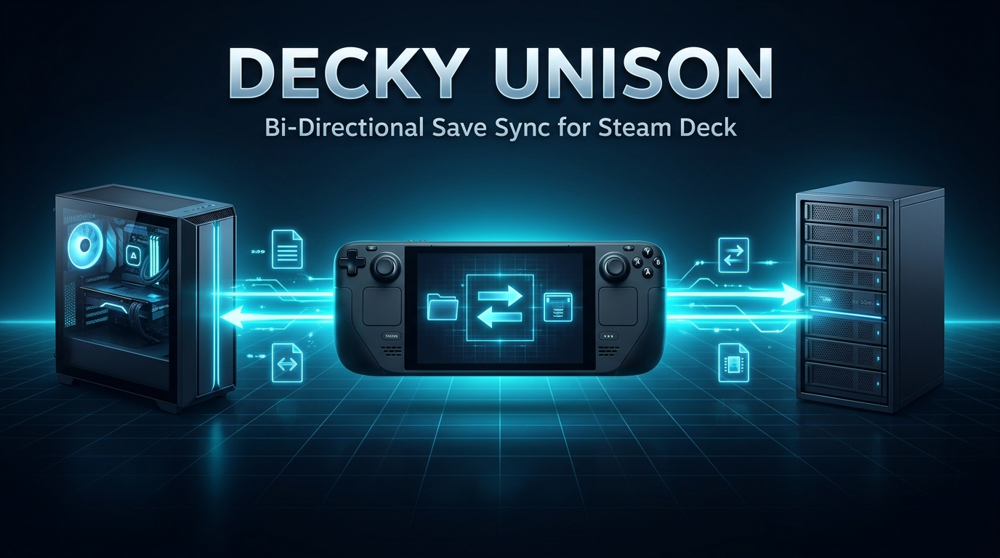

<div align="center">

# Decky Unison 🔄

<p align="center">
  
</p>

### Seamless, Bi-Directional Save File Synchronization for Non-Steam Games on Steam Deck

[](https://store.steampowered.com/steamos)
[](https://deckbrew.xyz/)
[](https://github.com/bcpierce00/unison)
[](LICENSE)
[](#development--testing)

<p align="center">
  <a href="#-key-features">Key Features</a> •
  <a href="#-quick-start">Quick Start</a> •
  <a href="#-architecture">Architecture</a> •
  <a href="#-transport-protocols">Transports</a> •
  <a href="#-troubleshooting--faq">Troubleshooting</a> •
  <a href="#-development--testing">Development</a>
</p>

</div>

---

## 📖 Overview

Standard **Steam Cloud** synchronization only protects native games purchased directly through Steam. If you play **Non-Steam Games**—such as titles installed via GOG, Epic Games Store, Battle.net, standalone Windows installers running through Proton/Wine, Flatpak apps, or emulators—your save files remain trapped in isolated Steam prefix containers (`compatdata`).

**Decky Unison** bridges this gap right from the SteamOS **Quick Access Menu (QAM)**. Powered by the mathematically proven **[Unison File Synchronizer](https://github.com/bcpierce00/unison)** engine, Decky Unison enables true bi-directional synchronization between your Steam Deck and any remote machine (Desktop Gaming PC, Central NAS, or Cloud VPS).

Unlike basic one-way tools (like rsync or simple cloud uploads), Unison detects modifications on **both** sides, prevents accidental overwrites, resolves conflicts according to your preferences, maintains precise timestamps, and creates versioned backup snapshots.

---

## ✨ Key Features

```
  ┌───────────────────────┐              True Bi-Directional              ┌───────────────────────┐
  │      Steam Deck       │               Synchronization                 │     Remote Target     │
  │  (Proton compatdata,  │  ◄─────────────────────────────────────────►  │  (PC / NAS / Server  │
  │ Flatpaks, Emulators)  │     ↑ Uploads, ↓ Downloads, Auto-Backups      │   Windows / Linux)    │
  └───────────────────────┘                                               └───────────────────────┘
```

- **🎯 Automatic Non-Steam Game Discovery**: Parses Valve's binary `shortcuts.vdf` on the fly to detect all added Non-Steam games and verify whether a Proton prefix (`pfx/drive_c/users/steamuser/`) has been created.
- **🧠 Intelligent Save Heuristics**: Automatically scans typical Windows save locations (`AppData/Local`, `AppData/Roaming`, `Saved Games`, `Documents/My Games`) and recommends the matching save directory with 1-click selection.
- **📁 Integrated Safe File Browser**: Built-in Game Mode directory navigator with contextual **Quick-Jump shortcuts** (`AppData`, `Documents`, `~/.var/app/` Flatpaks, and MicroSD card mounts `/run/media/*`).
- **🔀 Multi-Target Sync Per Game**: Configure multiple remotes for any game (e.g., *Desktop Gaming PC*, *Home TrueNAS*, *Cloud Backup*) and switch the active sync target with a single dropdown click.
- **🛡️ Built-in Versioned Save Protection**: Automatically creates safety snapshots (`-backup "Name *"`, default 5 backups) before modifying or replacing any save file.
- **🌐 Versatile Transport Protocols**:
  - **SSH Protocol**: Secure transport with automated `ed25519` keypair generation, full `~/.ssh/config` alias resolution, and 1-click password pairing.
  - **Socket Mode**: Ultra-fast direct TCP synchronization (`socket://host:port`) without SSH overhead—ideal for WireGuard, Tailscale, or trusted home LANs.
  - **Local / Share Mode**: Direct synchronization against local directories or mounted NFS/SMB/rclone network folders.
- **⚡ 1-Click Static Binary Management**: Auto-probes `PATH` and user storage. Features an in-plugin download button that fetches official, static glibc binaries directly to persistent user storage (`~/.config/decky-unison/bin/`), surviving SteamOS system updates without touching the read-only rootfs.
- **🎮 Gamepad-Optimized Experience**: Designed specifically for Steam Deck controller navigation with high-contrast outlines, glowing focus indicators, and touch-friendly controls.
- **📋 Live Terminal Logs & Diagnostics**: Review real-time sync output, commands executed, and diagnostic help for common errors (such as Exit Code 3 path or binary mismatches).

---

## 🚀 Quick Start

### 1. Remote PC / Server Setup

Decky Unison synchronizes against a remote replica using the Unison engine. Ensure Unison (**v2.54.0+**) is installed on your destination computer:

| Platform | Recommended Installation Command |
|---|---|
| **Windows 10 / 11** | `winget install bcpierce00.unison` *(or download static release from [GitHub](https://github.com/bcpierce00/unison/releases))* |
| **Linux (Ubuntu / Debian)** | `sudo apt install unison` or download the [official static binary](https://github.com/bcpierce00/unison/releases) |
| **Linux (Arch / Manjaro)** | `sudo pacman -S unison` |
| **TrueNAS / unRAID / Docker** | Available in standard app repositories or via static binary |
| **macOS** | `brew install unison` |

> [!TIP]
> **Windows Users**: Ensure `unison.exe` and your OpenSSH server executable (or OpenSSH Windows service) are in your Windows system `PATH`.

---

### 2. Configure a Remote in Decky Unison

1. Press the **`...` (QAM)** button on your Steam Deck and navigate to the **Decky Unison** tab.
2. If Unison is not yet installed on your Deck, click **Download Unison Binary** on the top notification banner.
3. Switch to the **Settings** tab and select **Add Remote Server**.
4. Choose your connection type:
   - **SSH (Recommended)**: Enter your server's IP address or hostname, user, and port (default: 22).
     - *Method A (1-Click Pairing)*: Switch authentication to **Password**, enter your remote user password once, and click **Pair SSH Key**. Decky Unison will automatically install its public key onto the server.
     - *Method B (Manual Key)*: Click **View Steam Deck Public Key**, copy the key, and append it to `~/.ssh/authorized_keys` on your server.
     - *Method C (Existing ~/.ssh/config)*: If you already have configured hosts in `~/.ssh/config`, Decky Unison detects and auto-fills them!
   - **Socket Mode**: Enter host and port (default: 26867) if running `unison -socket <port>` on your server.
   - **Local / Share**: Enter a mounted folder path (e.g. `/run/media/deck/Saves/`).
5. Click **Test Connection** to confirm connectivity.

---

### 3. Initialize & Sync a Game

1. On the **Games** tab, scroll to **Non-Steam Games Detected**.
2. Click **Initialize** on the game you wish to sync.
3. **Select Save Folder**:
   - Decky Unison automatically suggests recommended save locations inside the game's Proton prefix (e.g., `Documents / My Games: GameTitle`).
   - Click the suggested pill, or click **Browse...** to pick any folder using the interactive file browser.
4. **Configure Remote Target**:
   - Select your Remote.
   - Set the destination path (e.g. `/home/gamer/saves/GameTitle` or `C:/Saves/GameTitle`).
5. **(Optional) Fine-Tune Rules**:
   - Customize conflict resolution policy (`prefer = newer`, `Steam Deck`, or `Remote Server`).
   - Adjust maximum versioned backups (default: `5`).
6. Click **Save Configuration**, then press **Sync Now**!

---

## 🏗️ Architecture & Technical Design

Decky Unison is designed around non-blocking asynchronous execution and clean separation of concerns:

```
┌────────────────────────────────────────────────────────┐
│             SteamOS Quick Access Menu (QAM)            │
│  React 19 / TypeScript / @decky/ui / Gamepad-Optimized │
│  (src/index.tsx, components/, styles.ts, api.ts)       │
└───────────────────────────┬────────────────────────────┘
                            │ Decky callable RPC (WebSocket)
┌───────────────────────────▼────────────────────────────┐
│              Decky Python Plugin Daemon                │
│       Python 3.10+ Async Subprocess Execution          │
│                       (main.py)                        │
├───────────────┬────────────────┬───────────────────────┤
│ GameDetector  │  FileBrowser   │     RemoteManager     │
│ (VDF parser & │ (Safe scanner  │ (SSH keypair, config  │
│  pfx locator) │ & quick-jumps) │  resolver, & pairing) │
├───────────────┴────────────────┴───────────────────────┤
│       ConfigStore (~/.config/decky-unison/config.json) │
├────────────────────────────────┬───────────────────────┤
│         BinaryManager          │      UnisonRunner     │
│   (Static binary downloader,   │ (CLI argument builder │
│    PATH probe, version check)  │  & stream output/rc)  │
└────────────────┬───────────────┴───────────────┬───────┘
                 │ Local File Operations         │
                 ▼                               ▼
       ~/.config/decky-unison/bin/     Local / SSH / Socket
       unison (Static x86_64 ELF)      Sync Targets
```

For detailed technical specifications, internal state machines, RPC callable references, and data schemas, see **[AGENTS.md](AGENTS.md)**.

---

## 🌐 Transport Protocols Compared

| Feature | SSH Transport | Socket Transport | Local / Mounted Share |
|---|---|---|---|
| **Security** | Encrypted via OpenSSH (`id_ed25519`) | Unencrypted raw TCP stream | Filesystem permissions |
| **Best For** | Internet / VPS / Remote Gaming PC | WireGuard / Tailscale / Local Gigabit LAN | Mounted SMB/NFS/rclone shares |
| **Remote Prerequisites** | SSH Server + `unison` in PATH | `unison -socket 26867` running | Mounted local directory path |
| **Speed / Overhead** | Low CPU overhead, highly secure | Maximum throughput, zero crypto overhead | Kernel file I/O speed |

> [!IMPORTANT]
> **Path Formatting Rule**:
> Unison requires a double-slash syntax for absolute remote paths:
> - Linux/macOS SSH: `ssh://user@host//home/user/saves/Game`
> - Windows SSH: `ssh://user@host//C:/Saves/Game`
> Decky Unison formats these paths automatically when constructing commands.

---

## 🛠️ Unison CLI Toggles & Rules

Inside the game configuration modal under **Show Unison CLI Toggles**, you can customize:

- **Conflict Preference (`-prefer`)**:
  - `newer` *(Default)*: Automatically accepts the replica with the most recent file modification timestamp.
  - `root1`: Always prioritizes the local Steam Deck files if a conflict occurs.
  - `root2`: Always prioritizes the remote machine files if a conflict occurs.
- **Versioned Backups (`-backup`, `-maxbackups`)**:
  - Automatically archives timestamped copies of overwritten files inside a `.unison.backup` directory on the local machine.
- **Batch Mode (`-batch`)**:
  - Runs in non-interactive batch mode, suppressing any interactive terminal prompts.
- **Auto Approval (`-auto`)**:
  - Automatically executes all non-conflicting actions without requiring confirmation.
- **Ignore Archives (`-ignorearchives`)**:
  - Forces Unison to discard cached fingerprint archives and perform a full fresh comparison (useful if a sync was unexpectedly interrupted).
- **Extra Arguments**:
  - Pass any custom Unison command-line options directly (e.g. `-ignore "Name *.log"`).

---

## ❓ Troubleshooting & FAQ

### Exit Code 3 / Fatal Error: "Server: unison not found"
**Cause**: The remote machine does not have `unison` in its default SSH environment `PATH`.  
**Solution**:
1. Open the remote configuration modal in Decky Unison.
2. In **Advanced Settings**, specify the absolute path to Unison on the remote server in the **Remote Unison Executable** field (e.g. `/usr/local/bin/unison` or `C:\Program Files\Unison\unison.exe`).
3. Click **Test Connection** to confirm.

### Conflict Detected (`<-?->`)
**Cause**: Files were modified on both the Steam Deck and the remote server simultaneously since the last sync.  
**Solution**:
- If you have set **Conflict Resolution** to `newer`, Unison will automatically pick the latest file.
- If set to default and conflicting, inspect the log via the **View Log** button in Decky Unison to see which files differ.

### Will SteamOS updates wipe my Unison installation?
**No.** Decky Unison installs the static Unison binary and configuration into persistent user storage at `~/.config/decky-unison/bin/`. It does not touch the read-only rootfs (`/usr`), ensuring full persistence across SteamOS updates.

---

## 💻 Development & Testing

### Prerequisites
- Node.js (v18+) and `npm`
- Python 3.10+

### Setup & Build
```bash
# Clone the repository
git clone https://github.com/SteamDeckHomebrew/decky-unison.git
cd decky-unison

# Install frontend dependencies
npm install

# Build the frontend bundle (dist/index.js)
npm run build

# Or run frontend in watch mode during development
npm run watch
```

### Automated Backend Test Suite
Decky Unison includes automated tests covering binary parsing, VDF extraction, SSH config resolution, argument formulation, and plugin lifecycle:

```bash
python3 -m unittest discover -s tests -p "test_*.py" -v
```

---

## 📄 License

Decky Unison is licensed under the **BSD 3-Clause License**. See [LICENSE](LICENSE) for details.
Unison is an open-source tool developed by Benjamin C. Pierce and contributors, licensed under the GNU GPL.

---

## 💖 Credits & Acknowledgements

- **[Unison File Synchronizer](https://github.com/bcpierce00/unison)**: Benjamin C. Pierce, Trevor Jim, Jérôme Vouillon, and all Unison contributors for developing the mathematically proven bi-directional file synchronization engine.
- **[Decky Loader & SteamDeckHomebrew](https://github.com/SteamDeckHomebrew)**: The SteamDeckHomebrew community for the phenomenal Decky Loader plugin framework, `@decky/ui` components, and `@decky/api`.
- **[Valve Corporation](https://www.valvesoftware.com/)**: For the Steam Deck, SteamOS, Proton, and championing Linux gaming.
- **Open-Source Tools & Libraries**:
  - [React](https://react.dev/) & [Rollup](https://rollupjs.org/) for modern frontend bundling.
  - [React Icons](https://react-icons.github.io/react-icons/) for Game Mode iconography.
  - [OpenSSH](https://www.openssh.com/) for secure transport and cryptographic pairing.

